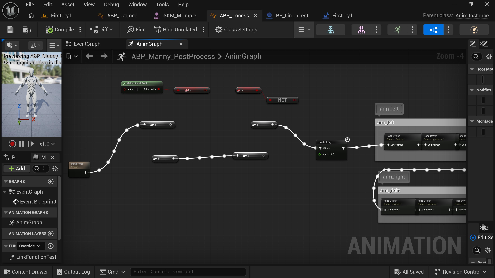
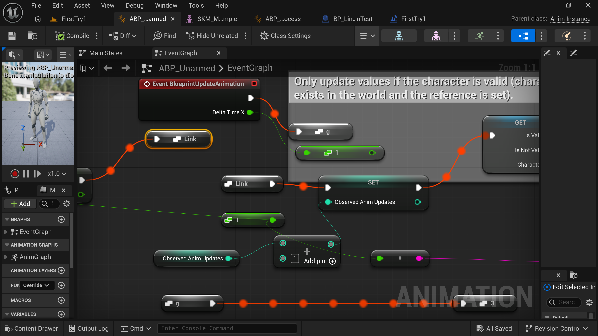

# Named Blueprint Links

By **Frainkey** · Stable 1.0.1 · Windows x64 · Unreal Engine 5.0–5.8 and 5.9 Preview 2

Named Blueprint Links replaces long Blueprint connections with named Declaration and Usage endpoints. A Declaration defines a signal; linked Usage nodes carry it near the nodes that consume it. Double-click a Usage to find its Declaration.

## What’s new in 1.0.1

- AnimGraph pose connections display a white pulse when the link is stale.
- Event Graph execution connections retain Unreal’s native red/orange pulse.
- Copying a complete Declaration/Usage pair creates fresh identity and remaps its Usages. Custom names, including names such as `Phase 2` and `Phase_2`, stay exactly as entered. Generated names use the compact sequence `Link`, `Link1`, `Link2`, and so on.
- Win64 packages are provided for Unreal Engine 5.0–5.8 and Unreal Engine 5.9 Preview 2. The 5.9 build remains a Preview 2 build.

## Screenshots

### AnimGraph pose links



The white pulse marks pose-link flow through the AnimGraph.

### Event Graph execution links



The Event Graph keeps Unreal’s native execution-wire pulse color.

## Download and install

Choose the ZIP matching your Unreal Engine version from the [GitHub Releases](https://github.com/frainkey1/NamedBlueprintLinks/releases) page:

- UE 5.0–5.8: `NBLv.1.0.1UE5.x.zip`, with the exact engine number in place of `x` (for example, `NBLv.1.0.1UE5.8.zip`).
- UE 5.9 Preview 2: `NBLv.1.0.1UE5.9P2.zip`.

Extract the ZIP into your project’s `Plugins` folder. Keep the top-level folder name from the archive. For example:

```
YourProject/Plugins/NBLv.1.0.1UE5.8/NamedBlueprintLinks.uplugin
```

Close and reopen the project, enable **Named Blueprint Links** under **Edit → Plugins**, and let the matching engine compile the plugin if prompted. The release ZIPs are built for Win64 with their matching Unreal Engine installation. Each ZIP is the official installable source-and-binary copy for that engine version; see [Compatibility/DeveloperNotes.md](Compatibility/DeveloperNotes.md) for version-specific source and dependency notes.

Keep a backup before adopting the plugin in an existing project.

## Create a named connection

1. Open a supported Blueprint Event Graph, function graph, or Animation Blueprint graph.
2. Search the graph action menu for **Named Link Declaration**.
3. Connect a data source to the Declaration input, or place the link along an execution or pose connection.
4. Rename the Declaration to describe the signal.
5. Right-click the Declaration and choose **Create Linked Usage**.
6. Move the Usage near its consumer and connect its output.
7. Compile and test the Blueprint. Double-click the Usage to navigate back to its Declaration.

Data Declarations allow multiple Usages and a local Declaration output. Execution Declarations allow one linked Usage. Named pose links carry AnimGraph poses. The Declaration and its Usages associate by identity, not by matching labels.

## Copy, rename, and recovery

Rename a Declaration to update all linked Usage labels. User-entered names remain intact when copied, including names ending in numbers or underscores. Generated fallback names are uniquified as `Link1`, `Link2`, and so forth.

Copy a complete Declaration/Usage pair to duplicate the association. A data Usage copied alone can retain its Declaration in the same graph; pasting it into another graph leaves it unresolved. Execution Usage-only copies remain unresolved. These nodes do not provide cross-graph or cross-Blueprint variables.

Deleting a required Declaration or leaving an invalid association produces a compile error. Undo can restore the association. Compile after editing and verify the affected behavior.

## Compatibility and known limits

See [Compatibility/BuildMatrix.md](Compatibility/BuildMatrix.md) for per-engine build and test evidence, and [docs/Validation.md](docs/Validation.md) for the feature checks.

- The published packages target Windows x64. A successful package build proves compilation for that engine; it does not by itself prove every Blueprint context or node type works.
- UE 5.9 is specifically **Preview 2**; this release does not claim compatibility with a later 5.9 preview or final release.
- Macros, arbitrary Blueprint contexts, and all data types are not blanket-certified.
- NBL pins do not offer **Split Struct Pin**. Use native producer/consumer split pins or Break/Make nodes around a whole typed link.
- Arbitrary reference qualifiers, container element types, delegates, networking, and untested engine features may require additional validation.
- Keep the plugin enabled while assets contain its nodes, including during cooking.

Before disabling or removing the plugin, replace its connections with ordinary wires, remove its nodes, compile, and save the affected assets.

## Support and issues

Use the **Support** button in Unreal’s plugin browser to open the [PayPal support page](https://www.paypal.com/donate/?hosted_button_id=RWT3F8XL7TTPE). For bugs and feature requests, use [GitHub Issues](https://github.com/frainkey1/NamedBlueprintLinks/issues). Include your engine version, plugin version, reproduction steps, expected and actual behavior, and relevant error text.

Maintenance and support are provided voluntarily as time permits. There are no guaranteed response times, fixes, future engine updates, or service levels.

## License and development

The plugin is available under the [MIT License](LICENSE). Unreal Engine is a separate prerequisite governed by Epic’s terms; this repository does not distribute engine source or grant rights to Unreal Engine.

On a machine with a C++17 compiler and Bash, run `bash Tests/run-local.sh` for the portable route-planner checks. This does not build Unreal or establish Linux support. Unreal automation tests use the `NamedBlueprintLinks` test prefix.

Developed with AI assistance; the plugin icon is generated artwork.
